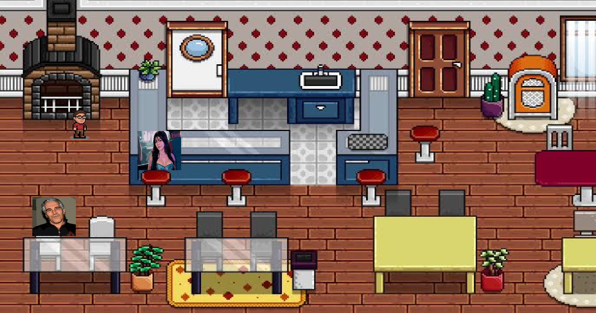
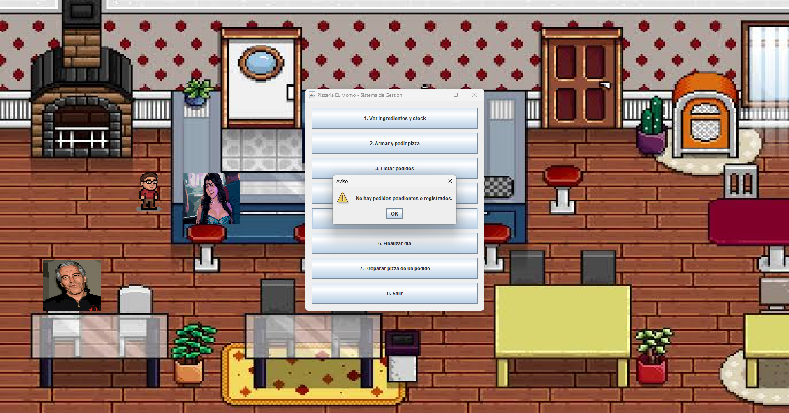

# Pizzería El Momo

Sistema de gestión de una pizzería con un juego en 2D hecho en Java. El personaje camina por el salón y la cocina, y al acercarse a un cliente o al horno se abre la ventana de gestión: armar pizzas, tomar y entregar pedidos, reponer stock y llevar el dinero de la caja.

## Integrantes

- Lucas Juarez
- Santiago Rodriguez

## Tecnología

- Java con **Swing** (interfaz gráfica)
- **FlatLaf** (diseño moderno)
- **Maven** (gestión del proyecto)
- **MySQL** (base de datos)

## Requisitos

- JDK 17 o superior
- Maven 3.8 o superior
- MySQL (incluido en USBWebserver v8.6.2, MySQL 5.6)

## Cómo ejecutarlo

1. **Clonar el repositorio**

   ```bash
   git clone https://github.com/JurezAnashe/Pizzeria-EL-Momo.git
   cd proyecto-base
   ```

2. **Crear la base de datos**

   ```bash
   mysql -u root -p < pizzeria.sql
   ```

   El script crea la base `pizzeria`, las tablas y los datos de ejemplo.

3. **Configurar la conexión**
   La conexión está en todos los Impl y usa los valores por defecto de USBWebserver:
   - URL: `jdbc:mysql://localhost:3306/pizzeria`
   - Usuario: `root`
   - Contraseña: `usbw`

   También se puede importar desde phpMyAdmin: en Importar vas a elegir y elegis `pizzeria.sql`.

4. **Compilar**

   ```bash
   mvn clean compile
   ```

5. **Ejecutar**
   ```bash
   mvn exec:java
   ```

## Controles

- Moverse: flechas del teclado o `W`, `A`, `S`, `D`
- Acercarse a un cliente o al horno: abre la ventana de gestión
- Puerta blanca del salón: entrada a la cocina

## Funciones de la ventana de gestión

1. Ver ingredientes y stock
2. Armar y pedir pizza
3. Listar pedidos
4. Reponer stock
5. Entregar pedido
6. Finalizar día
7. Preparar pizza de un pedido

## Estructura del proyecto

```
proyecto-base/
├── pom.xml
├── pizzeria.sql
├── docs/                 # capturas de pantalla
└── src/main/
    ├── java/src/
    │   ├── Dao/          # acceso a datos
    │   ├── Excepciones/  # excepciones
    │   ├── model/        # clases del modelo
    │   ├── Service/      # lógica de negocio
    │   └── juego.java    # ventana del juego
    └── resources/src/img/  # imágenes
```

## Capturas




